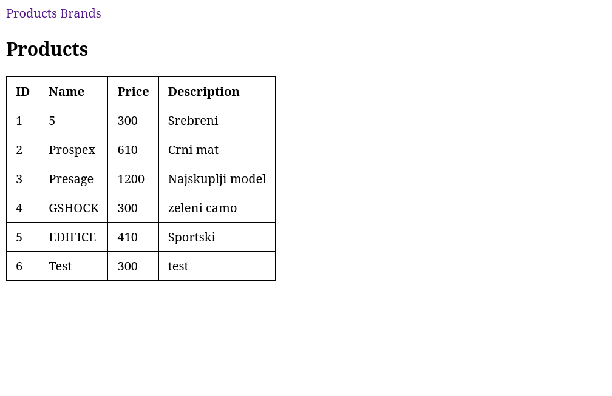
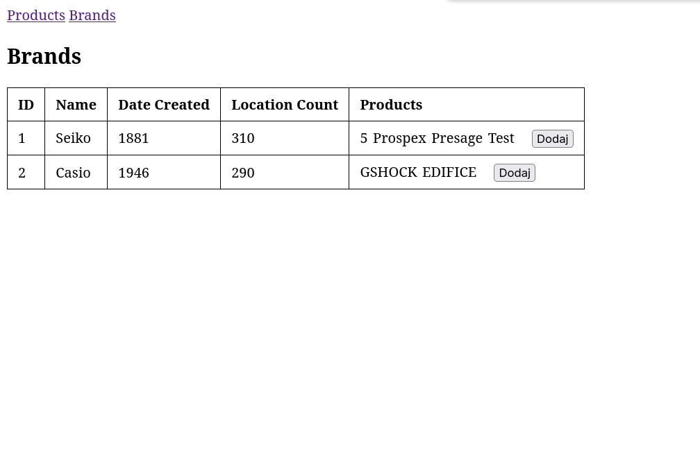

## Primjer

- Seiko ima proizvode: 5, Prospex, Presage
- Casio ima proizvode: GSHOCK, EDIFICE

# Modna kolekcija 2026

## Članovi tima

- Amel Kolašević
- Dino Matković

## Opis aplikacije

Modna kolekcija 2026 je Spring MVC web aplikacija za prikaz i upravljanje brandovima i proizvodima. Aplikacija omogućava pregled svih brandova, pregled svih proizvoda i dodavanje novog proizvoda postojećem brandu.

## Tehnologije

- Java 27
- Spring Boot
- Spring MVC
- Thymeleaf
- Maven
- HTML/CSS

## Modeli i relacije

Aplikacija ima dva glavna modela: `Brand` i `Product`.

### Brand

Brand predstavlja proizvođača i sadrži:

- id
- name
- dateCreated
- locationCount
- listu proizvoda

### Product

Product predstavlja proizvod i sadrži:

- id
- name
- price
- description

### Relacija

Jedan brand može imati više proizvoda.

## Funkcionalnosti

- prikaz svih brandova
- prikaz svih proizvoda
- prikaz proizvoda po brandu
- dodavanje novog proizvoda brandu

## Rute

| Ruta | Opis |
|---|---|
| `/` | Preusmjerava na `/brands` |
| `/brands` | Lista svih brandova |
| `/products` | Lista svih proizvoda |
| `/brands/{id}/products/add` | Forma za dodavanje proizvoda brandu |

## Screenshot aplikacije

### Lista brandova

### Lista proizvoda

### Korišteni alati

- Jetbrains AI Assistant
